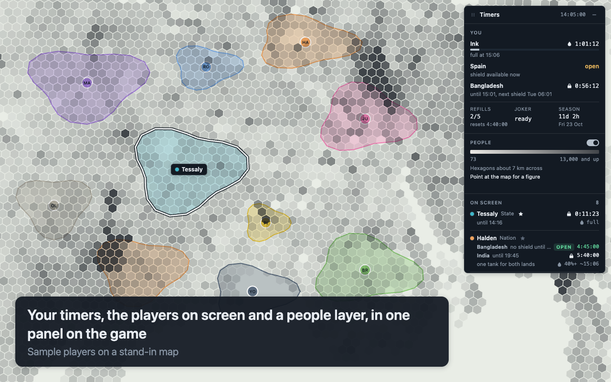
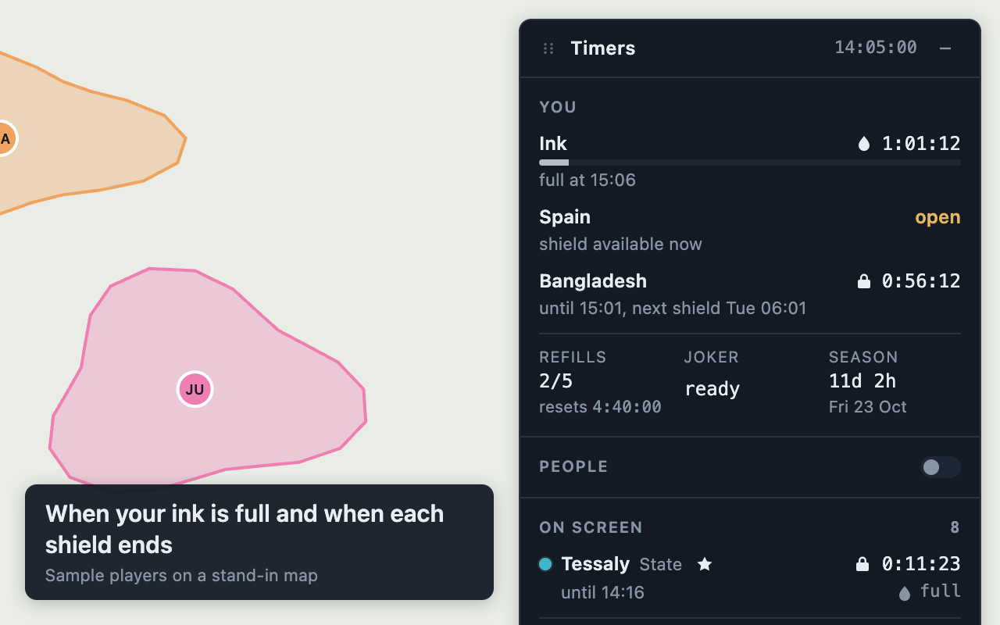
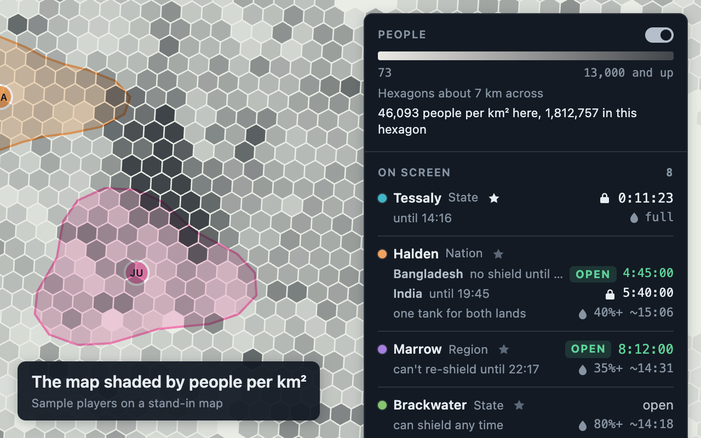

# InkDom Timers (unofficial)

A browser extension, for Chrome and Firefox, for people who play [InkDom](https://inkdom.io/play). It adds one panel to the game with your
own timers and those of the players on your screen, and a layer you can switch on that shades the map by how many
people live there. It is not made by, or endorsed by, the game's developer.

The pictures show sample players on a stand-in map.

## What it shows

- You: when your ink is full, each land's shield and when you can shield it again, refills, Joker, season end.
- Neighbours: for every player in your current map view, their shield countdown, the window in which they cannot
  shield again, and an estimate of their ink. Pan or zoom and the list follows. Pin a player to keep the row.
- Hover a row and that player's land outline lights up on the map, with their name on it.
- People: switch on "People" in the panel, under your own timers, and the map is shaded by people per km², in the
  hexagons the game counts people in. The panel shows the scale, the hexagon size in use, and the figure for the
  hexagon under your pointer. Zoomed out, the hexagons get larger and show sums.

## What it does and does not do

- It reads responses the game already receives: the map view and its members, the world feed, the player and
  alliance directories, land lists and land shapes, your shop data and the season. It also reads the game's own
  ink label. Land shapes are held in memory for the hover outline and never saved.
  It makes no requests of its own. From requests it reads exactly one thing: the four map edges in the game's own
  "who is in view" question, which it needs to place the hover outline. It never looks at request headers, where
  the login is.
- It never clicks, draws, buys or sends anything.
- The people layer is one extra element inside the game's map. Its numbers ship inside the extension: Kontur's
  public population data, which the game's own guide names as its source. They are not read from the game.
- The game's page can tell the extension is installed: the people data file is readable from inkdom.io, and the
  layer is an element in the page. Nothing is hidden from the game's developer.
- Several of those responses include other players' exact ink. The extension does not copy it. Neighbour ink is an
  estimate from their last loop and their rank, and a bought refill makes the real figure higher.
- Nothing leaves your browser. There is no server and no analytics.
- Clock times are 24-hour `HH:MM` in your computer's own time zone, whatever its language and region settings.

What it reads and what it saves on your computer is set out in full in [PRIVACY.md](PRIVACY.md).

## Install

Add it from the
[Chrome Web Store](https://chromewebstore.google.com/detail/inkdom-timers-unofficial/iacgoflofeajgjjoimckhggdjjkniamm),
then open or reload https://inkdom.io/play.

To run it from this folder instead:

1. Download this folder.
2. Open `chrome://extensions`, switch on Developer mode, click "Load unpacked" and choose the folder.
3. Open or reload https://inkdom.io/play.

On Firefox, desktop or Android, it will come from addons.mozilla.org once that listing is up. To run it from this
folder on desktop Firefox meanwhile, open `about:debugging#/runtime/this-firefox`, click "Load Temporary Add-on"
and choose `manifest.json`; it stays until Firefox is closed.

Chrome 111 or later, or Firefox 140 or later (142 on Android).

## Limits

- The game only refreshes its map data while its tab is in front, so the panel is live only then. Countdowns keep
  running from the last known times.
- A neighbour's "can't re-shield until" time is known once the extension has seen their shield, or after you open
  their player card once.
- With the game's sidebar unfolded there is no ink label to read, so your ink time is computed and marked `~`.
- The hover outline uses the land shapes the game sends in full. At wide zooms the game sends simplified shapes,
  so the outline can sit a few pixels off the border the map draws.
- A player whose shape has not arrived yet gets a ring instead, at a point the game gives for their land. That
  point is inside the land but can be far from the avatar, over sea, or off screen; off screen, the ring is
  dashed and held at the screen edge in that direction.
- New-player protection is worked out from a player's first loop ever. If the game protects returning players
  again each season, the panel does not show that.
- If the game changes its data format the panel says so, or rows stop updating, until the extension is updated.
- While the map moves, the people layer slides and scales along with it, read off the map's pins and scale bar,
  and is drawn afresh when the game asks who is in the new view, usually within a second. A zoomed-in drawing is
  blurry until then. A move is noticed through the game's land pins, so with none on screen a pan leaves the
  layer holding still and a zoom hides it until the next view; if none comes within 8 seconds, the layer is shown
  again as it was.
- The layer dims the game's place names where it is dark. At the game's two widest zooms, with most of the world
  on screen, it is not drawn and the panel says it is waiting for the map view. In a large window it moves to
  larger hexagons sooner, because it draws at most about 25,000 at a time.
- The people figures are Kontur's release of 2023-11-01. The game may use another release, and it gives you the
  share of a hexagon your land covers, so what a loop pays can differ from the figures shown.

## Known gaps in 0.5.0

Firefox was checked with the smoke test's stand-in page in Firefox Developer Edition, not in live play, and not
on Android.

The people layer was checked in live play on 2026-10-11: the game's sidebar, toolbar, buttons and avatars stay on
top of it, it lines up with the map, and it follows the game's zoom buttons. The redraw on the game's view
request was checked on 2026-10-12. Not yet checked in live play: the layer sliding and scaling with a drag or a
wheel zoom, which reads the pixel offset out of the game's pin transforms and hides if it cannot; a long
north-south pan with a single pin on screen, where the scale bar's change with latitude is read as a slight zoom
until the next view; the game's dialogs over the layer; and drawing a loop with it on.

Not yet checked in live play: countdowns after returning to the tab from another window, the ink row after a loop
with the game's sidebar unfolded, and drawing a loop right next to the panel. Dragging was checked with real mouse
input on the demo page, not in the game.

Small things left as they are:

- State is saved every 5 seconds whenever anything changed; 30 to 60 seconds would do.
- A two-land player sorts by land 1, not by whichever land changes soonest.
- A family or flag emoji at the 40 character edge of a name can show a broken glyph.
- After the extension is updated, reloaded or removed, a game tab that was already open keeps its old panel. That
  panel goes on counting but can no longer save what it learns, until the tab is reloaded.
- The in-view list is capped at 1,000 players, fewer than a whole-world zoom can hold.
- The pill's "N open" counts pinned players even when they are off screen.
- A click that lands on a row in the instant it is rebuilt is lost.
- A hostile page could make the extension hold an unbounded number of player records in memory.
- There is no unit test for the ink label's minute-flip logic, nor for a `fetch` that returns a non-promise.

## Development

- `npm test` runs the unit tests (Node 20, no dependencies). The package tests use the `zip` and `unzip` commands.
- `tools/demo.html` shows the panel with sample data, served from the repository root with any static server.
- `node tools/smoke.js` builds the package, loads it into a Chrome for Testing build against local sample
  responses and prints what the panel shows. Set `CHROME` to the browser's path if it is not in Playwright's cache.
- `npm run package` writes `dist/inkdom-timers-<version>.zip`: the manifest with `src/`, `vendor/`, `data/` and
  `icons/`, and nothing else. It needs the `zip` command.
- `node tools/build-art.js` renders the icons in `icons/` from the two SVG files in `store/`. It needs the
  `rsvg-convert` command.
- `node tools/store-shots.js` takes the Chrome Web Store pictures in `store/` again, from `tools/store.html`:
  the real panel and people layer over a stand-in map with invented players. It uses the same Chrome as the
  smoke tool.
- `tools/capture/` is a separate dev-only extension that records response shapes.
- `node tools/build-people.js <path to the .gpkg>` rebuilds `data/people-r6.bin` from Kontur's download. It needs
  the `sqlite3` command. `vendor/h3-js.umd.js` is h3-js 4.5.0's `dist/h3-js.umd.js`, unmodified.

## Releasing

1. Set the new version in `manifest.json`, `package.json` and the version test in `test/manifest.test.js`, and
   rename the "Known gaps" heading above.
2. Run `npm test` and `node tools/smoke.js`.
3. If the panel or the layer looks different, run `node tools/store-shots.js` and look at the pictures.
4. Run `npm run package` and upload the zip in the Chrome Web Store developer dashboard.

`store/listing.md` has the text for every field of the listing and of the privacy form. The privacy policy the
store links to is `PRIVACY.md`.

## Credits

- People data: [Kontur Population](https://data.humdata.org/dataset/kontur-population-dataset-3km), 3 km hexagons,
  release 2023-11-01, CC BY.
- Hexagon grid: [H3](https://h3geo.org/) (h3-js 4.5.0), Apache-2.0. Its licence and notice are in `vendor/`.
